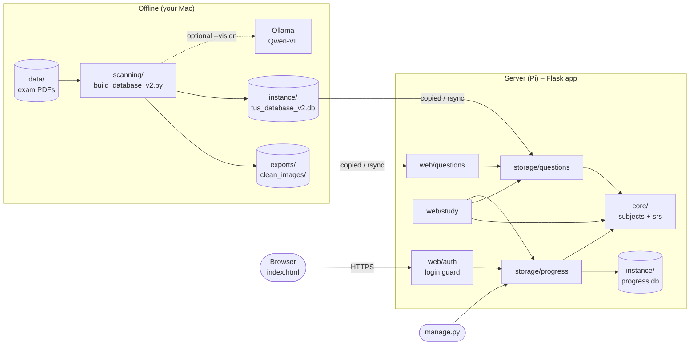
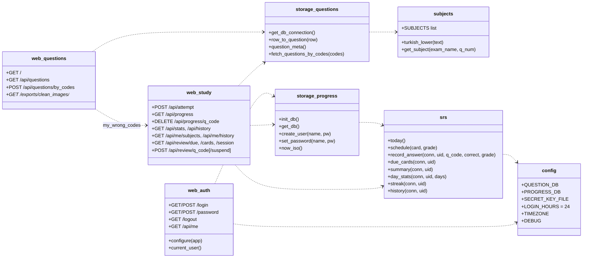
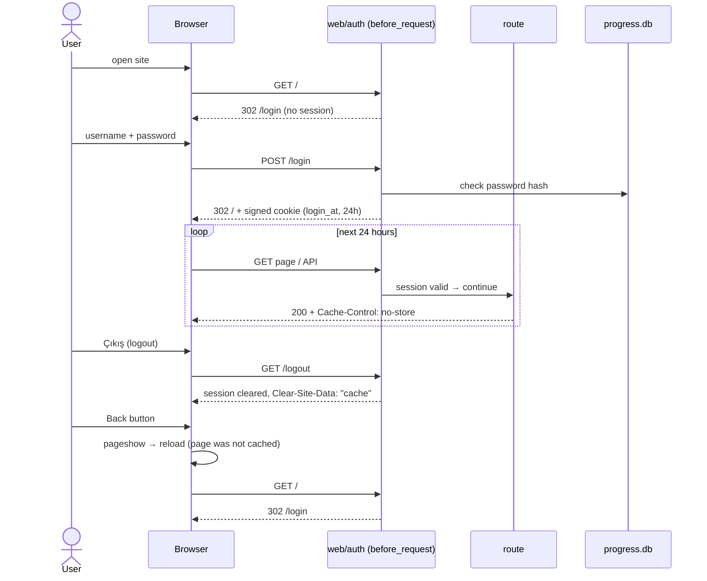
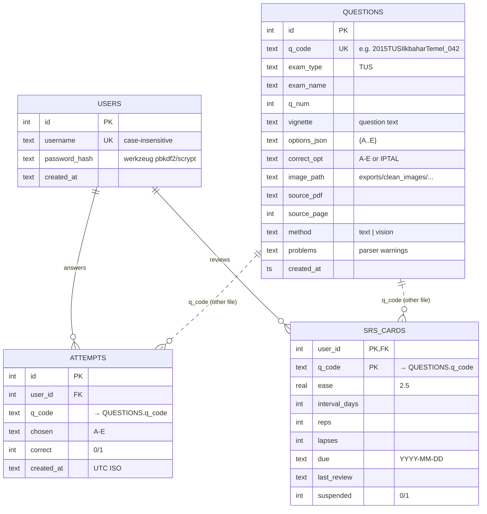

# TusBakalım – Architecture

TusBakalım is a small Flask web app for practising past TUS exam questions,
with personal logins, saved progress and Anki-style spaced repetition.
It has two independent halves:

* **Scanning (offline)** – turns exam PDFs into a question database.
* **Web app (online)** – serves the questions and stores each user's progress.

They only meet through one file: `instance/tus_database_v2.db`.

## 1. Folder layout

```
TusBakalım/
├── run.py                    entry point (python run.py / gunicorn run:app)
├── manage.py                 user admin CLI (add-user, set-password, ...)
├── requirements.txt
├── tusbakalim/               the web application (Python package)
│   ├── __init__.py           create_app(): wires everything together
│   ├── config.py             all paths + settings (env-overridable)
│   ├── core/                 PURE LOGIC – no Flask, no files
│   │   ├── subjects.py       exam + question no. -> TUS subject
│   │   └── srs.py            spaced-repetition scheduling + statistics
│   ├── storage/              DATABASE ACCESS
│   │   ├── questions.py      question bank (read-only)
│   │   └── progress.py       users, attempts, review cards
│   ├── web/                  HTTP ROUTES (Flask blueprints)
│   │   ├── auth.py           login/logout/password, login guard, no-cache
│   │   ├── questions.py      main page, search, images
│   │   └── study.py          answers, stats, history, daily review
│   └── templates/            index.html, login.html, password.html
├── scanning/                 OFFLINE PDF -> DATABASE TOOLS
│   ├── build_database_v2.py  builds instance/tus_database_v2.db
│   ├── scan_all_exams.py     audit report of all PDFs
│   └── diagnose_broken_exams.py
├── docs/                     this file
│
│   ---- private, git-ignored ----
├── instance/                 progress.db, tus_database_v2.db, secret_key.txt
├── data/                     source exam PDFs
├── exports/clean_images/     question images cut from the PDFs
└── archive/                  old versions + experiments
```

Dependency rule: `web → storage → core → config`. Lower layers never import
higher ones, so `core/` can be tested or reused (e.g. a mobile app) without Flask.

## 2. Component overview



## 3. Module (UML class) diagram



## 4. Login lifecycle (sequence)



## 5. Database schema

Two SQLite files, on purpose: the question bank can be rebuilt at any time
without touching anyone's progress. They are linked only by the text key
`q_code` (no foreign key across files).



| File | Tables | Written by | In Git? |
|---|---|---|---|
| `instance/tus_database_v2.db` | `questions` | `scanning/build_database_v2.py` | no |
| `instance/progress.db` | `users`, `attempts`, `srs_cards` | web app, `manage.py` | **never** |
| `instance/secret_key.txt` | – (signs login cookies) | created on first start | **never** |

## 6. Security & privacy notes

* Passwords are stored only as salted hashes (werkzeug).
* Every route except `/login` and `/password` needs a login (`web/auth.configure`).
* Login cookie: HttpOnly, SameSite=Lax, expires 24 h after login
  (not extended by activity). Set `TUS_HTTPS=1` behind HTTPS to also mark it Secure.
* Private pages are sent with `Cache-Control: no-store`; logout sends
  `Clear-Site-Data: "cache"`; the page reloads itself when restored with
  the Back button → logged-out users cannot see cached pages.
* Flask debug mode is off unless `TUS_DEBUG=1` (the debugger allows remote code execution).
* Exam PDFs, images, databases and the secret key are git-ignored.

## 7. Possible add-ons

**Quick wins**
1. **Login rate limiting** – lock an account / IP for a few minutes after 5 wrong passwords (Flask-Limiter).
2. **CSRF tokens** on login and password forms (Flask-WTF).
3. **"Log out everywhere"** – store a `session_version` per user; bump it on password change.
4. **Mock exam mode** – timed 200-question session with the real subject distribution and a score report.
5. **Bookmarks / notes per question** – new table `notes(user_id, q_code, text, starred)`.

**Learning features**
6. **Explanations** – the `topic / explanation / tip` columns are already read by `row_to_question`; fill them with a batch job (LLM or manual).
7. **Weak-topic recommendations** – use `/api/me/subjects` accuracy to build a daily mix weighted toward weak subjects.
8. **Ranking among friends** – weekly leaderboard from `attempts` (opt-in).
9. **Score prediction** – estimate TUS score from recent accuracy per subject.

**Platform**
10. **PWA / offline mode** – service worker + manifest, so it installs on the phone home screen.
11. **Mobile app / API tokens** – `core/` is Flask-free, so a JSON API for an app is easy.
12. **Postgres instead of SQLite** – only `storage/` would change.
13. **Automatic backups** of `progress.db` (nightly `sqlite3 .backup` + copy off the Pi).
14. **Docker / systemd unit + Caddy** for one-command deploy with automatic HTTPS.
15. **Tests + GitHub Actions** – pytest for `core/srs.py` and `core/subjects.py`, run on every push.
16. **Admin page** – manage users and fix wrongly-parsed questions (`problems` column) in the browser.
